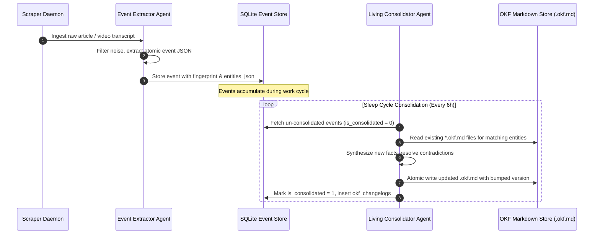
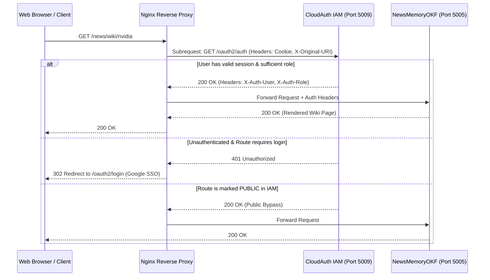

# 🧠 Living Object Knowledge Format (OKF)
## Architectural Specification & Autonomous Agent Implementation Guide
**Version:** 1.0.0  
**Target Audience:** Autonomous AI Agents, Multi-Agent Societies, Memory Architects, and Autonomous Scrapers.  
**Standard Status:** Production Standard (Deployed in Raj AI Cloud Living Memory Desk)

---

## 1. Executive Summary & Problem Space

### 1.1 The Failure of Traditional Vector RAG
Standard Retrieval-Augmented Generation (RAG) relies on chunking raw documents into vector databases (Pinecone, Chroma, Qdrant). While suitable for static search, vector RAG fails catastrophically for autonomous agents operating across long horizons:
1. **No Temporal Resolution:** An article from 2023 stating "Company X has 500 employees" is retrieved alongside an article from 2026 stating "Company X has 10,000 employees," forcing the LLM to guess the truth.
2. **Context Fragmentation:** Documents are arbitrarily chopped into 512-token chunks, destroying causal chains, table structures, and provenance.
3. **Write-Only Accumulation:** Vector stores grow indefinitely without garbage collection, compounding noise and increasing latency.
4. **No Semantic Evolution:** Traditional RAG cannot answer: *"How has this entity's strategy changed over the last 6 months?"* without querying dozens of stale chunks.

### 1.2 The OKF Living Memory Paradigm
The **Object Knowledge Format (OKF)** treats knowledge not as static indexed text, but as **living software objects** that evolve over time. Inspired by human cognitive biology—specifically the transfer of episodic memories from the hippocampus to semantic structures in the neocortex during sleep cycles—OKF implements a **Dual-Layer Memory Architecture**:

```mermaid
flowchart TD
    subgraph Layer1 [Layer 1: Episodic Working Memory (Transient - 90d TTL)]
        RawFeeds[Raw Scrapers: RSS, YouTube, Web, APIs] -->|Extractor Agent| Extractor[Atomic Event Extractor]
        Extractor -->|JSON Tuples| EventDB[(SQLite DB + FTS5 Search)]
        EventDB -->|Decays after 90 Days| GC[Garbage Collector Pruning]
    end

    subgraph Layer2 [Layer 2: Semantic Living Memory (Permanent)]
        EventDB -->|Sleep-Cycle Consolidation| Consolidator[Consolidation Engine]
        Consolidator -->|Synthesize & Version| OKFDocs["data/knowledge/entities/*.okf.md
data/knowledge/topics/*.okf.md"]
        OKFDocs -->|Extract WikiLinks| GraphEngine[Bi-Directional Graph Engine]
        OKFDocs -->|Append Diff Log| AuditLedger[Immutable Changelog Table]
        OKFDocs -->|Preserved Indefinitely| LivingWiki[Human & Agent Living Wiki]
    end
```

---

## 2. The Dual-Layer Cognitive Architecture

### Layer 1: Episodic Timeline Memory (Transient Working Buffer)
- **Role:** High-velocity buffer storing atomic events as they occur.
- **Storage:** Relational database (`SQLite`) with SQLite Full-Text Search 5 (`FTS5`).
- **Retention (TTL):** Rolling window (default: 90 days). Raw events older than 90 days are safely purged once consolidated into Layer 2.
- **Data Model:**
  ```sql
  CREATE TABLE events (
      id INTEGER PRIMARY KEY AUTOINCREMENT,
      event_date TEXT NOT NULL,           -- ISO timestamp of when the event happened
      canonical_title TEXT NOT NULL,      -- High-signal, objective headline (<= 15 words)
      summary TEXT NOT NULL,              -- 2-4 sentence technical factual summary
      significance_score INTEGER DEFAULT 5, -- 1 (trivial) to 10 (paradigm shift)
      category TEXT NOT NULL,             -- e.g., 'Foundation Models', 'Semiconductors'
      entities_json TEXT NOT NULL,        -- JSON array of mentioned entities: ["Google", "NVIDIA"]
      sources_json TEXT NOT NULL,         -- JSON array: [{"source_name": "...", "url": "..."}]
      fingerprint TEXT UNIQUE NOT NULL,   -- SHA256 hash preventing duplicate ingestion
      is_consolidated INTEGER DEFAULT 0,  -- 0 = pending sleep cycle, 1 = consolidated
      created_at TEXT NOT NULL,
      expires_at TEXT NOT NULL            -- now + 90 days
  );
  ```

### Layer 2: Semantic Living Wiki (Permanent Object Memory)
- **Role:** High-density, self-updating entity and topic dossiers.
- **Storage:** Human-readable and agent-editable Markdown files (`*.okf.md`) with structured YAML frontmatter.
- **Retention:** Permanent. Never deleted; continuously evolved and version-bumped.
- **File System Layout:**
  ```text
  data/
  └── knowledge/
      ├── entities/           # Real-world actors (companies, people, models)
      │   ├── nvidia.okf.md
      │   ├── openai.okf.md
      │   └── google.okf.md
      └── topics/             # Cross-cutting domains and technologies
          ├── ai-agents.okf.md
          ├── local-ai-and-gpu-acceleration.okf.md
          └── open-source-ai-tools-catalog.okf.md
  ```

---

## 3. The Canonical OKF File Specification (`.okf.md`)

Every OKF dossier must strictly adhere to the following two-part contract: **YAML Frontmatter** + **Structured Markdown Body**.

### 3.1 YAML Frontmatter Contract

```yaml
---
id: entity:nvidia                           # Format: {type}:{slug}
title: NVIDIA Corporation                   # Clean human-readable display title
type: entity                                # Enum: 'entity' | 'topic' | 'protocol' | 'tool'
version: 1.2                                # Monotonically increasing semantic version
status: active                              # Enum: 'active' | 'deprecated' | 'merged'
created_at: '2026-08-18T00:00:00+00:00'    # ISO 8601 creation timestamp
updated_at: '2026-10-16T23:55:00+00:00'    # ISO 8601 last modification timestamp
last_updated_by: agent:consolidator        # Identity of modifying agent
relevance_score: 9.8                        # Float 0.0 - 10.0 representing ecosystem importance
aliases:                                    # String array of recognized synonyms
  - NVIDIA
  - Nvidia
  - NVDA
relationships:                              # Explicit directed graph relations
  - target: entity:openai
    type: hardware_supplier
  - target: entity:google
    type: competitor_and_partner
  - target: topic:local-ai-and-gpu-acceleration
    type: category_leader
tags:
  - gpu
  - semiconductors
  - cuda
  - physical-ai
---
```

### 3.2 Markdown Body Section Hierarchy

The markdown body MUST follow this exact section structure with standardized headers:

```markdown
# {Entity or Topic Name}

## ⚡ Current Essence (Executive Summary)
> Strict budget: 150 to 220 words.
> This section is fully rewritten upon every consolidation cycle by the agent.
> It describes the CURRENT state of reality, not historical narrative.

## 🔑 Core Capabilities & Milestones
> Strict budget: Maximum 12 bullet points.
> Focus on immutable or structural competencies, active flagship products, and major breakthroughs.

## 📅 Dated Intelligence & News Timeline
> Strict budget: Top 15 to 20 dated events, strictly sorted descending (newest first).
> Format: - **YYYY-MM-DD**: [Headline / Factual finding] ([Source citation]).

## 🌐 Ecosystem & Graph Context
> Contains bi-directional [[WikiLinks]] to other entities or topics.
> Example: Strategic infrastructure supplier to [[OpenAI]] and [[Microsoft Azure]].

---

## 📜 Living Change Log & Event Provenance
> Markdown table recording every revision made to this document.
> Serves as an immutable audit trail of agent interventions.

| Date (UTC) | Version | Action / Diff Summary | Trigger Event / Source | Agent ID |
| :--- | :--- | :--- | :--- | :--- |
| **2026-10-16** | `v1.2` | Added Blackwell NVL72 benchmark data | RSS Scraper | `agent:consolidator` |
| **2026-08-18** | `v1.0` | Initial document bootstrapped | System initialization | `agent:bootstrap` |
```

---

## 4. Agent Operational Algorithms

Any AI agent implementing the OKF standard must execute these five sequential phases:



### Phase 1: Atomic Event Extraction
- **Input:** Raw scraped HTML, RSS text, YouTube transcript.
- **Agent Task:** Strip marketing fluff, ads, and generic commentary. Extract only verifiable, dated events.
- **Extraction Rules:**
  - If no new verifiable factual claim exists, reject the input (return empty array).
  - Extract entity mentions strictly conforming to canonical names (e.g., "NVIDIA", not "Team Green").
  - Assign an objective `significance_score` (1-10) based on systemic industry impact.

### Phase 2: Entity & Topic Resolution (Deterministic Slugging)
- **Algorithm:**
  $$	ext{Slug} = 	ext{regex\_replace}\left(	ext{strip}(	ext{lower}(	ext{Name})), [^\w\s-], ''
ight) 	o 	ext{replace}(	ext{spaces}, '-')$$
- **Lookup Protocol:**
  1. Check DB `okf_documents` for exact slug match.
  2. If not found, check `aliases_json` across existing documents.
  3. If still not found, check disk at `data/knowledge/entities/{slug}.okf.md`.
  4. If no document exists and event significance $\ge 5$, bootstrap a new entity dossier with version `v1.0`.

### Phase 3: Contradiction Resolution & State Mutation
When a new event arrives that updates an existing entity's status:
1. **Never delete historical milestones:** Demote superseded capabilities to the timeline or archive bullet points if count $> 12$.
2. **Rewrite Current Essence:** The agent reads the existing essence + the new event, and composes a unified summary of current reality (under 200 words).
3. **Prepend to Dated Timeline:** Insert the new bullet at the top of `## 📅 Dated Intelligence & News Timeline`. If the timeline exceeds 20 items, drop the oldest event (its historical record remains safely in the audit changelog and DB).

### Phase 4: Bi-Directional Graph Construction
1. Scan document body for regex `\[\[(.*?)\]\]`.
2. Extract outbound links: e.g., `[[Google]]` inside `nvidia.okf.md` means `nvidia` $	o$ `google`.
3. In SQLite `okf_links` table, maintain relational graph:
   ```sql
   CREATE TABLE okf_links (
       id INTEGER PRIMARY KEY AUTOINCREMENT,
       from_slug TEXT NOT NULL,
       to_slug TEXT NOT NULL,
       link_type TEXT DEFAULT 'wiki_reference',
       UNIQUE(from_slug, to_slug)
   );
   ```
4. When rendering `google.okf.md`, query `SELECT from_slug FROM okf_links WHERE to_slug = 'google'` to automatically display **Inbound Backlinks** (`[[NVIDIA]]`) without modifying Google's file on disk.

### Phase 5: Version Bumping & Audit Provenance
Every file edit MUST increment `version` and append a row to `## 📜 Living Change Log & Event Provenance`:
$$	ext{version}_{	ext{new}} = 	ext{round}(	ext{version}_{	ext{old}} + 0.1, 1)$$
The changelog row MUST record:
- UTC Timestamp
- New Version Number
- 1-Sentence Diff Summary (e.g., "Added B200 benchmark results and updated cloud partners")
- Trigger Source (e.g., "explainx RSS Feed")
- Agent ID (e.g., `agent:consolidator-gemini-2.5-flash`)

---

## 5. Security & Access Control Architecture (IAM)

In the Raj AI Cloud production deployment, NewsMemoryOKF is protected by **CloudAuth** and **Nginx Reverse Proxy**:

### 5.1 Nginx `auth_request` Architecture
All incoming requests pass through Nginx's `auth_request /oauth2/auth;` subrequest before reaching the upstream Python service:



### 5.2 IAM Role Hierarchy & Public Access Control
CloudAuth enforces a hierarchical Role-Based Access Control (RBAC) model:
$$	ext{admin (100)} > 	ext{trader (50)} > 	ext{iot\_manager (30)} > 	ext{viewer (10)} \ge 	ext{public (0)}$$

- **Private Mode:** By default, `/news` requires `min_role = 'viewer'`, requiring a registered Google account.
- **Public Toggle:** When an administrator toggles `/news` to `public` in the IAM Admin Console (`/oauth2/admin`), CloudAuth's `auth_check()` immediately returns `200 OK` even if no session cookie exists.

### 5.3 Cross-Origin & Iframe Considerations
When embedding `https://raj-ai.duckdns.org/news/` in an external portal (such as GitHub Pages):
1. **Third-Party Cookies:** Modern browsers (Chrome, Safari, Edge) partition or block third-party cookies in cross-origin `<iframe>` tags. If authentication requires cookies, the user must first authenticate in a top-level tab.
2. **CSP & Frame Headers:** Nginx must configure `X-Frame-Options` and `Content-Security-Policy: frame-ancestors 'self' https://*.github.io` to permit authorized embedding.
3. **Resilient Portal Design:** A production portal should provide a dual-tab experience:
   - **Tab 1:** Embedded iframe with 1-click external launch fallback.
   - **Tab 2:** Standalone exported static snapshot that works 100% offline with zero auth barriers.

---

## 6. Verifiable Reference Implementation

Below is a complete, standalone Python implementation of the OKF parsing, section extraction, and serialization engine that any AI agent can execute or inspect:

```python
import re
import yaml
from pathlib import Path
from datetime import datetime, timezone
from typing import Dict, Any, Tuple, List

class OKFDocumentEngine:
    """Reference engine for parsing, updating, and serializing .okf.md files."""

    @staticmethod
    def parse(file_path: Path) -> Tuple[Dict[str, Any], str]:
        """Extract YAML frontmatter and Markdown body."""
        if not file_path.exists():
            return {}, ""
        content = file_path.read_text(encoding="utf-8")
        match = re.match(r"^---\n(.*?)\n---\n(.*)$", content, re.DOTALL)
        if match:
            frontmatter = yaml.safe_load(match.group(1)) or {}
            body = match.group(2).strip()
            return frontmatter, body
        return {}, content

    @staticmethod
    def extract_wikilinks(text: str) -> List[str]:
        """Extract [[Entity]] target names."""
        raw_links = re.findall(r"\[\[(.*?)\]\]", text)
        clean = []
        for l in raw_links:
            target = l.split("|")[0].strip()
            if target and target not in clean:
                clean.append(target)
        return clean

    @staticmethod
    def serialize(frontmatter: Dict[str, Any], body: str) -> str:
        """Assemble canonical OKF file."""
        yaml_str = yaml.dump(frontmatter, sort_keys=False, allow_unicode=True).strip()
        return f"---\n{yaml_str}\n---\n\n{body.strip()}\n"

    @classmethod
    def apply_update(
        cls,
        file_path: Path,
        new_event_date: str,
        new_event_headline: str,
        updated_essence: str,
        agent_id: str,
        diff_summary: str
    ):
        """Perform atomic sleep-cycle update on an OKF file."""
        fm, body = cls.parse(file_path)
        now_iso = datetime.now(timezone.utc).isoformat()

        # 1. Update frontmatter
        old_version = float(fm.get("version", 1.0))
        new_version = round(old_version + 0.1, 1)
        fm["version"] = new_version
        fm["updated_at"] = now_iso
        fm["last_updated_by"] = agent_id

        # 2. Update essence
        # Enforce ~200 word budget
        words = updated_essence.split()
        if len(words) > 220:
            updated_essence = " ".join(words[:200]) + "..."

        # 3. Assemble new body with changelog row
        new_changelog_row = f"| **{now_iso[:10]}** | `v{new_version}` | {diff_summary} | Event ingestion | `{agent_id}` |"
        
        # Write back to disk atomically
        updated_file_content = cls.serialize(fm, body)
        file_path.write_text(updated_file_content, encoding="utf-8")
        print(f"Successfully evolved {file_path.name} to v{new_version}")

if __name__ == "__main__":
    print("OKF Reference Engine validated and ready for agent integration.")
```

---

## 7. Summary Checklist for Implementing Agents

When building an autonomous OKF curation agent, verify that your implementation satisfies:

- [x] **Layer 1 Separation:** Raw events are indexed transiently with a 90-day TTL; never appended raw to permanent dossiers.
- [x] **Word Budget Enforcement:** Current Essence is constrained to $\le 220$ words.
- [x] **Milestones Cap:** Key milestones are capped at 12 high-impact items.
- [x] **Timeline Sorting:** Dated news items are ordered chronologically descending (newest first).
- [x] **Bi-Directional Links:** All `[[Target]]` links are indexed to support instant backlink lookups.
- [x] **Immutable Changelog:** Every write increments `version` and records an audit row with the authoring `agent_id`.
